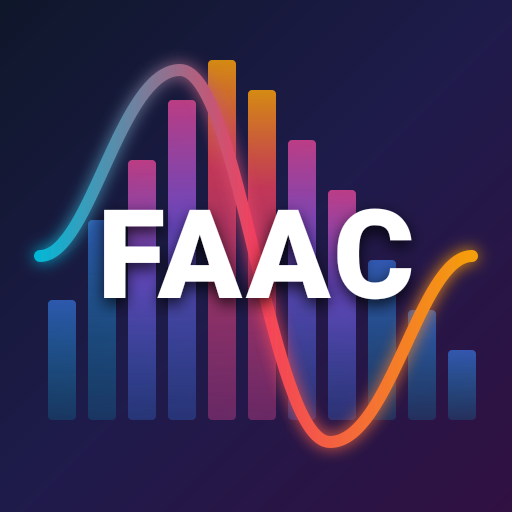

#  Freeware Advanced Audio Coder

FAAC is an open-source, dependency-free AAC encoder, with FAAD as its decoder, aimed at embedded and pipeline use cases where footprint and throughput matter as much as quality.

### Key features:

- MPEG-4 AAC-LC, HE-AAC v1 (SBR) and HE-AAC v2 (PS) encoding and decoding
- Sample rates from 8 kHz to 96 kHz, supporting mono up to 7.1 multichannel
- VBR, ABR and CBR rate control
- Advanced encoding tools: Dynamic block-switching, PNS, and TNS
- Flexible output options: ADTS and raw AAC streams
- PCM sample-rate conversion with Fast, Good, and High presets; downsampling
  input above 48 kHz uses High

### Command-line tools:

- `faac` encodes WAV or raw PCM to AAC in ADTS or MP4/M4A; MP4 output includes
  gapless playback info
- `faad` decodes ADTS or MP4/M4A AAC to WAV or raw PCM, with optional mono or
  stereo downmixing and stdin/stdout support
- `faar` changes the sample rate of WAV or raw PCM audio, with adjustable
  quality and optional dithering when converting to integer PCM
- `faam` muxes, demuxes and tags MP4/M4A/M4B (AAC, H.264/H.265)

> **Important:** The use of this software may require the payment of patent royalties. You need to consider this issue before you start building derivative works. We are not warranting or indemnifying you in any way for patent royalties! **YOU ARE SOLELY RESPONSIBLE FOR YOUR OWN ACTIONS!**

## Usage

```sh
faac input.wav -o output.m4a          # encode PCM to AAC in MP4
faad output.m4a -o decoded.wav        # decode AAC to PCM
faad -i output.m4a                    # show stream information
faar -r 48000 in_96k.wav out_48k.wav  # resample to 48 kHz
faam -i output.aac -o output.m4a      # mux ADTS into MP4
faam tag output.m4a --title Song      # edit tags in place
```

## Build

Install Meson and Ninja, then build and install the suite:

```sh
meson setup build
meson compile -C build
meson test -C build --print-errorlogs
meson install -C build
```

### Build options

| Option | Default | Description |
|--------|---------|-------------|
| `decoder` | true | Build `libfaad` and the `faad` frontend |
| `decoder-dab` | true | Digital Audio Broadcasting (960/120 frame length) support in `libfaad` |
| `decoder-drc` | true | Dynamic range control support in `libfaad` |
| `decoder-ps` | true | Parametric Stereo (HE-AAC v2) support in `libfaad`; needs `decoder-sbr` |
| `decoder-sbr` | true | Spectral Band Replication (HE-AAC v1) support in `libfaad` |
| `encoder` | true | Build `libfaac` and the `faac` frontend |
| `encoder-ps` | false | Enable HE-AAC v2 Parametric Stereo encoding; needs `encoder-sbr` |
| `encoder-sbr` | true | Spectral Band Replication (HE-AAC v1) support in `libfaac`; false builds an LC-only encoder |
| `frontend` | true | Build the command-line tools |
| `frontend-static` | false | Link the frontend executables to the static libraries |
| `max-channels` | 8 | Maximum number of channels (1-8) |
| `muxer` | true | Build the `faam` command-line tool (`libfaam` is always built) |
| `muxer-fragmented` | true | `libfaam`: fragmented MP4 recording and demuxing |
| `muxer-video` | true | `libfaam`: H.264/H.265 video tracks |
| `resampler` | true | Build the `faar` command-line tool (`libfaar` is always built) |
| `resampler-float` | false | Use the float-only resampler engine for FPU-less targets; the default mixed build uses double at High quality |
| `sbr-decimation` | 1 | Encoder Spectral Band Replication analysis density (1 = full quality, up to 8 = faster) |
| `stats` | false | End-of-stream diagnostics on stderr (instrumentation only) |

## Library APIs

Applications can link the component libraries directly. Their public C APIs,
build instructions, and usage details are documented here:

- [FAAC encoder API](docs/libfaac.md)
- [FAAD decoder API](docs/libfaad.md)
- [FAAR resampler API](docs/libfaar.md)
- [FAAM MP4 muxer and demuxer API](docs/libfaam.md)

## Copyrights

FAAC, FAAD, FAAR and FAAM are free software, licensed under the GNU Lesser General Public License (LGPL), version 2.1 or later:

```
FAAC - Freeware Advanced Audio Coder
Copyright (C) 1999-2001, Menno Bakker
Copyright (C) 2002-2017, Krzysztof Nikiel
Copyright (C) 2004, Dan Villiom P. Christiansen
Copyright (C) 2005-2026, Fabian Greffrath
Copyright (C) 2026, Nils Schimmelmann

This library is free software; you can redistribute it and/or
modify it under the terms of the GNU Lesser General Public
License as published by the Free Software Foundation; either
version 2.1 of the License, or (at your option) any later version.

This library is distributed in the hope that it will be useful,
but WITHOUT ANY WARRANTY; without even the implied warranty of
MERCHANTABILITY or FITNESS FOR A PARTICULAR PURPOSE.  See the GNU
Lesser General Public License for more details.
```
