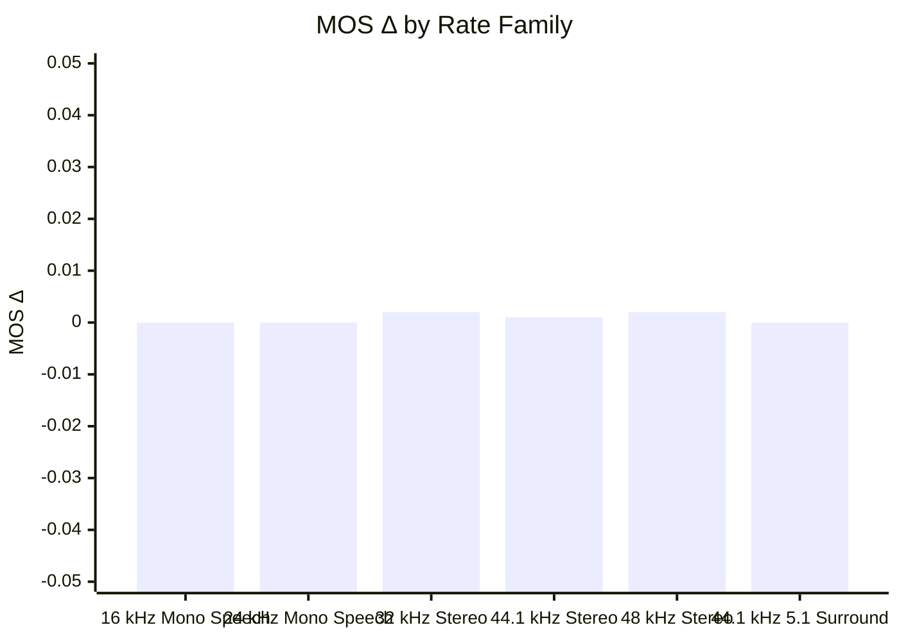
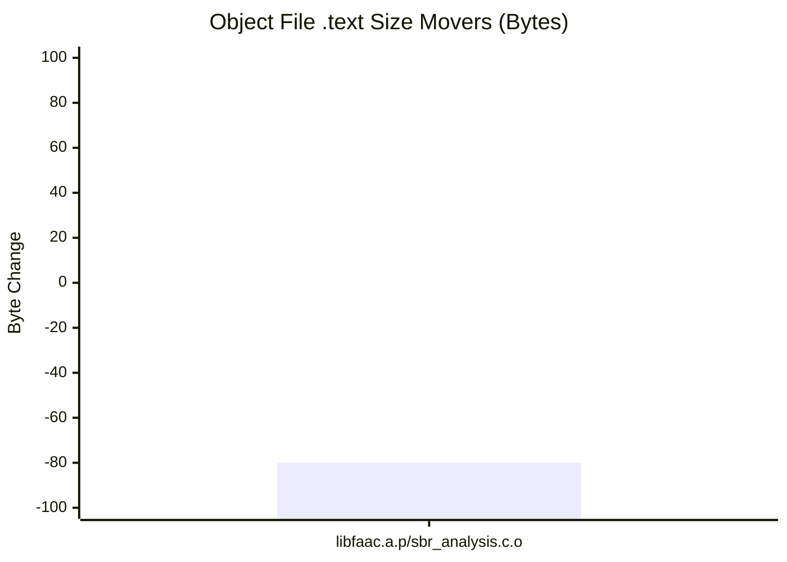

## ⚠️ Performance Regression Detected

### Environment
- **Baseline SHA**: `d7a6effe22e0dd86d30c9147649542b937021c7d`
- **Candidate SHA**: `c50b66aab79f754fc17e2550159a861d26403b65`

### Executive 3-Pillar Balance
| Pillar | Metric | Change vs Baseline | Status |
| :--- | :--- | :---: | :---: |
| 🎧 **Quality** | Perceptual MOS Δ | `+0.001 MOS` | ✅ Pass |
| ⚡ **Performance** | Speed (Throughput Δ) | `+0.0%` | ✅ Pass |
| 📦 **Footprint** | Code Footprint Δ | `-0.12%` | ✅ Pass |

### Summary Details
| Metric | Value |
| :--- | :--- |
| **Regressions** | 3 ⚠️ |
| **Worst MOS Drop** | -0.10 (48k_stereo_24k: clapton_44k.16b48k.wav) |
| **Max Bitrate Err** | +29.9% (48k_stereo_16k: 4-Sound-English-male.441.16b48k.wav) 📈 |
| **Significant Wins** | 1 🌟 |
| **Consistency** | 67.1% |
| **Throughput Δ** | +0.0%  (LC: +0.0%, HE: +0.1%) |
| **Worst-case TP Δ** | -6.4% (arm64_cbr / 16k_mono_24k) ⚠️ |
| **Library Size** | -0.12% 📉 |
| **Bitrate Accuracy** | 99.6% 🎯 |
| **Avg MOS Δ** | +0.001 ⚠️ Quality Churn (144 clips improved, 63 degraded) |
| **Worst Stereo Drop** | -0.0293 (48k_stereo_320k: 35_SQAM_glockenspiel_cut.16b48k.wav) |

#### MOS Δ by Rate Family

| Family | MOS Δ | 95% Conf. Interval | Clips |
| :--- | :---: | :---: | :---: |
| 16 kHz Mono Speech | +0.000 | [+0.000, +0.000] | 128 |
| 24 kHz Mono Speech | +0.000 | [+0.000, +0.000] | 80 |
| 32 kHz Stereo | +0.002 | [+0.000, +0.004] ✳ | 245 |
| 44.1 kHz Stereo | +0.001 | [+0.000, +0.001] ✳ | 245 |
| 48 kHz Stereo | +0.002 | [+0.001, +0.002] ✳ | 637 |
| 44.1 kHz 5.1 Surround | +0.000 | [+0.000, +0.000] | 6 |

### ❌ Top Regression Details (Top 3 of 3)

#### arm64_cbr
| Test Case | Status | MOS (Base) | Delta | Target | Actual | Acc % | Speed Δ | Bit-Exact |
| :--- | :---: | :---: | :---: | :---: | :---: | :---: | :---: | :---: |
| 48k_stereo_24k: clapton_44k.16b48k.wav | ⚠️ | 3.44 (3.53) | -0.10 | 24k | 23.9k | 99.6% | -8.6% | ❌ |
| 48k_stereo_16k: clapton_44k.16b48k.wav | ⚠️ | 2.90 (2.96) | -0.06 | 16k | 16.2k | 98.8% | -9.5% | ❌ |
| 48k_stereo_24k: bas.wav | ⚠️ | 2.72 (2.77) | -0.05 | 24k | 23.8k | 99.1% | -10.9% | ❌ |

decoder output: skipped (no decoder_diff block)

<b>📋 View Scenario Performance Details</b>

### Scenario Performance
| Scenario | Rate | MOS Δ | 95% Conf. Interval | Wins / Losses | Stereo Fid. Δ | Transient | Throughput Δ | Bitrate Acc |
| :--- | :---: | :---: | :---: | :---: | :---: | :---: | :---: | :---: |
| **16 kHz Mono Speech** | | | | | | | | |
| 16k_mono_20k | 16k/1ch | +0.000 | [+0.000, +0.000] | 0/0 | N/A | ➖ (n=0) | -4.1% | 99.7% |
| 16k_mono_24k | 16k/1ch | +0.000 | [+0.000, +0.000] | 0/0 | N/A | ➖ (n=0) | -6.4% | 99.8% |
| 16k_mono_voip_24k | 16k/1ch | +0.000 | [+0.000, +0.000] | 0/0 | N/A | ➖ (n=0) | -2.6% | 99.8% |
| **24 kHz Mono Speech** | | | | | | | | |
| 24k_mono_28k | 24k/1ch | +0.000 | [+0.000, +0.000] | 0/0 | N/A | ➖ (n=0) | -5.4% | 99.7% |
| 24k_mono_32k | 24k/1ch | +0.000 | [+0.000, +0.000] | 0/0 | N/A | ➖ (n=0) | -4.7% | 99.8% |
| **32 kHz Stereo** | | | | | | | | |
| 32k_stereo_16k | 32k/2ch | +0.011 | [+0.002, +0.022] ✳ | 22/12 | +0.0003 | ➖ (n=1129) | -2.4% | 99.0% |
| 32k_stereo_48k | 32k/2ch | +0.000 | [+0.000, +0.000] | 0/0 | +0.0002 | ➖ (n=683) | -0.4% | 99.5% |
| 32k_stereo_64k | 32k/2ch | +0.000 | [+0.000, +0.000] | 0/0 | +0.0003 | ➖ (n=683) | -0.3% | 99.7% |
| 32k_stereo_80k | 32k/2ch | +0.000 | [+0.000, +0.000] | 0/0 | +0.0003 | ➖ (n=683) | -2.2% | 99.9% |
| 32k_stereo_96k | 32k/2ch | +0.000 | [+0.000, +0.000] | 0/0 | +0.0003 | ➖ (n=683) | -2.3% | 99.9% |
| **44.1 kHz Stereo** | | | | | | | | |
| 44k1_stereo_64k | 44.1k/2ch | +0.004 | [+0.002, +0.005] ✳ | 15/1 | +0.0002 | ➖ (n=1092) | -1.6% | 99.9% |
| 44k1_stereo_128k | 44.1k/2ch | +0.000 | [+0.000, +0.000] | 0/0 | +0.0006 | ➖ (n=683) | -0.4% | 99.9% |
| 44k1_stereo_160k | 44.1k/2ch | +0.000 | [+0.000, +0.000] | 0/0 | +0.0007 | ➖ (n=683) | -1.8% | 99.9% |
| 44k1_stereo_192k | 44.1k/2ch | +0.000 | [+0.000, +0.000] | 0/0 | +0.0007 | ➖ (n=683) | -1.3% | 99.9% |
| 44k1_stereo_256k | 44.1k/2ch | +0.000 | [+0.000, +0.000] | 0/0 | +0.0007 | ➖ (n=683) | -1.3% | 99.8% |
| **48 kHz Stereo** | | | | | | | | |
| 48k_stereo_16k | 48k/2ch | +0.003 | [-0.002, +0.008] | 17/14 | -0.0012 | ➖ (n=1138) | -2.3% | 97.0% |
| 48k_stereo_24k | 48k/2ch | -0.000 | [-0.007, +0.006] | 12/16 | -0.0006 | ➖ (n=1149) | -2.0% | 99.5% |
| 48k_stereo_32k | 48k/2ch | +0.002 | [-0.001, +0.005] | 16/9 | -0.0008 | ➖ (n=1163) | -1.5% | 99.5% |
| 48k_stereo_40k | 48k/2ch | +0.004 | [+0.002, +0.007] ✳ | 16/4 | -0.0007 | ➖ (n=1165) | -1.1% | 99.6% |
| 48k_stereo_48k | 48k/2ch | +0.004 | [+0.001, +0.006] ✳ | 15/4 | -0.0006 | ➖ (n=1160) | -1.1% | 99.7% |
| 48k_stereo_56k | 48k/2ch | +0.005 | [+0.003, +0.008] ✳ | 18/2 | -0.0006 | ➖ (n=1187) | -1.4% | 99.8% |
| 48k_stereo_64k | 48k/2ch | +0.004 | [+0.002, +0.006] ✳ | 13/1 | -0.0007 | ➖ (n=1172) | -1.6% | 99.9% |
| 48k_stereo_96k | 48k/2ch | +0.000 | [+0.000, +0.000] | 0/0 | -0.0006 | ➖ (n=683) | -1.2% | 99.8% |
| 48k_stereo_128k | 48k/2ch | +0.000 | [+0.000, +0.000] | 0/0 | -0.0006 | ➖ (n=683) | -0.9% | 99.9% |
| 48k_stereo_160k | 48k/2ch | +0.000 | [+0.000, +0.000] | 0/0 | -0.0005 | +0.0002 📈 (n=683) | +0.0% | 99.9% |
| 48k_stereo_192k | 48k/2ch | +0.000 | [+0.000, +0.000] | 0/0 | -0.0006 | ➖ (n=683) | -2.0% | 99.9% |
| 48k_stereo_256k | 48k/2ch | +0.000 | [+0.000, +0.000] | 0/0 | -0.0006 | ➖ (n=683) | -1.7% | 99.8% |
| 48k_stereo_320k | 48k/2ch | +0.000 | [+0.000, +0.000] | 0/0 | -0.0006 | ➖ (n=683) | -1.0% | 99.8% |
| **44.1 kHz 5.1 Surround** | | | | | | | | |
| 44k1_51_96k | 44.1k/6ch | +0.000 | N/A | N/A | +0.0000 | ➖ (n=1) | -0.4% | 99.8% |
| 44k1_51_160k | 44.1k/6ch | +0.000 | N/A | N/A | +0.0000 | ➖ (n=1) | -2.3% | 99.9% |
| 44k1_51_224k | 44.1k/6ch | +0.000 | N/A | N/A | +0.0000 | ➖ (n=1) | +1.2% | 99.8% |
| 44k1_51_256k | 44.1k/6ch | +0.000 | N/A | N/A | +0.0000 | ➖ (n=1) | -0.3% | 99.9% |
| 44k1_51_384k | 44.1k/6ch | +0.000 | N/A | N/A | +0.0000 | ➖ (n=1) | +0.2% | 99.9% |
| 44k1_51_448k | 44.1k/6ch | +0.000 | N/A | N/A | +0.0000 | ➖ (n=1) | +0.9% | 100.0% |

_Transient fidelity measures attack centroid shift (smearing/delay of transient attacks, in ms). 📈 = improved, 📉 = regression, ➖ = neutral/insufficient onsets (<30)._
_✳ Statistically significant change (95% confidence interval excludes 0)_

<b>❌ View Regression Details (3)</b>

#### arm64_cbr
| Test Case | Status | MOS (Base) | Delta | Target | Actual | Acc % | Speed Δ | Bit-Exact |
| :--- | :---: | :---: | :---: | :---: | :---: | :---: | :---: | :---: |
| 48k_stereo_24k: clapton_44k.16b48k.wav | ⚠️ | 3.44 (3.53) | -0.10 | 24k | 23.9k | 99.6% | -8.6% | ❌ |
| 48k_stereo_16k: clapton_44k.16b48k.wav | ⚠️ | 2.90 (2.96) | -0.06 | 16k | 16.2k | 98.8% | -9.5% | ❌ |
| 48k_stereo_24k: bas.wav | ⚠️ | 2.72 (2.77) | -0.05 | 24k | 23.8k | 99.1% | -10.9% | ❌ |

<b>View Additional Suite Details</b>

#### ✅ arm64_cbr
- MOS Δ: +0.001, TP Δ: +0.0%, Size Δ: -0.12%
- Bitstream Consistency: 67.1%

**Gates**
- ⚠️ `mos`: 3 clip(s) past -0.05
- ✅ `footprint`: .text+.rodata+.data 68944 -> 68864 (-80 bytes, -0.12%)
- ✅ `throughput`: instruction count x1.000 (95% CI 1.000-1.000) over 12 signal(s)
- ✅ `bd_rate`: audio_32k/Low Complexity +0.000%, audio_44k1/Low Complexity +0.000%, audio_48k/HE-AAC v1 -0.138%, audio_48k/Low Complexity +0.000%, audio_51/Low Complexity +0.000%
- ✅ `haze`: atk_he_q50 pre-onset error +0.0 dB mean, +0.0 dB worst kick; ctl_he_q50 haze +0.0->+0.0 dB; ctl_lc_q200 haze -0.0->-0.0 dB; he_b32 haze +7.3->+7.3 dB; he_q50 haze +13.8->+13.8 dB; lc_q200 haze +15.4->+15.4 dB

**BD-rate** (positive = more bits for equal quality = worse)
| Ladder | Rungs | Clips | Mean | Median |
| :--- | :---: | :---: | :---: | :---: |
| audio_32k / Low Complexity | 4 | 49 | +0.000% | +0.000% |
| audio_44k1 / Low Complexity | 4 | 49 | +0.000% | +0.000% |
| audio_48k / HE-AAC v1 | 7 | 49 | -0.138% | -0.086% |
| audio_48k / Low Complexity | 6 | 49 | +0.000% | +0.000% |
| audio_51 / Low Complexity | 4 | 1 | +0.000% | +0.000% |
- audio_32k / HE-AAC v1: 1 rung(s), needs 3 -- skipped
- audio_44k1 / HE-AAC v1: 1 rung(s), needs 3 -- skipped
- audio_51 / HE-AAC v1: 2 rung(s), needs 3 -- skipped
- speech_clean_16k / Low Complexity: 2 rung(s), needs 3 -- skipped
- speech_clean_24k / Low Complexity: 2 rung(s), needs 3 -- skipped
- speech_voip_16k / Low Complexity: 1 rung(s), needs 3 -- skipped

**Object .text movers**

`libfaac.a.p/sbr_analysis.c.o` -80

_Full per-clip test cases (1341 total) exported to `cases_cbr.md`._

