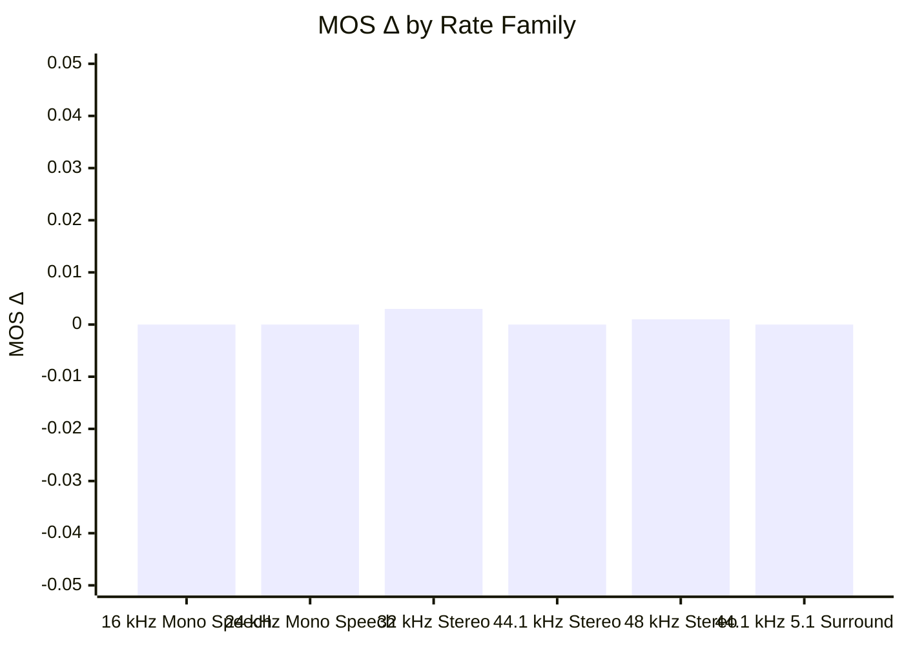

## ❌ Gapless Regression Detected

### Environment
- **Baseline SHA**: `d7a6effe22e0dd86d30c9147649542b937021c7d`
- **Candidate SHA**: `c50b66aab79f754fc17e2550159a861d26403b65`

### Executive 3-Pillar Balance
| Pillar | Metric | Change vs Baseline | Status |
| :--- | :--- | :---: | :---: |
| 🎧 **Quality** | Perceptual MOS Δ | `+0.001 MOS` | ✅ Pass |
| ⚡ **Performance** | Speed (Throughput Δ) | `+0.0%` | ✅ Pass |
| 📦 **Footprint** | Code Footprint Δ | `-0.10%` | ✅ Pass |

### Summary Details

#### ABR
| Metric | Value |
| :--- | :--- |
| **Regressions** | 4 ⚠️ |
| **Worst MOS Drop** | -0.10 (48k_stereo_24k: clapton_44k.16b48k.wav) |
| **Max Bitrate Err** | -34.8% (44k1_51_448k: 6_Channel_ID.wav) 📉 |
| **Significant Wins** | 1 🌟 |
| **Consistency** | 67.1% |
| **Throughput Δ** | -0.0%  (LC: -0.0%, HE: -0.0%) |
| **Worst-case TP Δ** | -4.3% (amd64_abr / 16k_mono_20k) ⚠️ |
| **Library Size** | -0.06%  |
| **Bitrate Accuracy** | 98.3% 🎯 |
| **Avg MOS Δ** | +0.001 ⚠️ Quality Churn (143 clips improved, 69 degraded) |
| **Worst Stereo Drop** | -0.0070 (48k_stereo_16k: Last_Of_The_Mohicanz__Sample_.16b48k.wav) |

#### CBR
| Metric | Value |
| :--- | :--- |
| **Regressions** | 3 ⚠️ |
| **Worst MOS Drop** | -0.10 (48k_stereo_24k: clapton_44k.16b48k.wav) |
| **Max Bitrate Err** | +29.9% (48k_stereo_16k: 4-Sound-English-male.441.16b48k.wav) 📈 |
| **Significant Wins** | 1 🌟 |
| **Consistency** | 67.1% |
| **Throughput Δ** | +0.0%  (LC: +0.0%, HE: +0.1%) |
| **Worst-case TP Δ** | -6.4% (arm64_cbr / 16k_mono_24k) ⚠️ |
| **Library Size** | -0.12% 📉 |
| **Bitrate Accuracy** | 99.6% 🎯 |
| **Avg MOS Δ** | +0.001 ⚠️ Quality Churn (144 clips improved, 63 degraded) |
| **Worst Stereo Drop** | -0.0293 (48k_stereo_320k: 35_SQAM_glockenspiel_cut.16b48k.wav) |

#### VBR
| Metric | Value |
| :--- | :--- |
| **Regressions** | 0 ✅ |
| **Worst MOS Drop** | -0.01 (32k_stereo_48k: 27-last-song-drums-and-trampets.441.16b48k.wav) |
| **Significant Wins** | 2 🌟 |
| **Consistency** | 67.1% |
| **Throughput Δ** | +0.0%  (LC: +0.0%, HE: +0.0%) |
| **Worst-case TP Δ** | -5.2% (arm64_vbr / 24k_mono_28k) ⚠️ |
| **Library Size** | -0.12% 📉 |
| **Avg MOS Δ** | +0.002 ⚠️ Quality Churn (103 clips improved, 6 degraded) |

#### MOS Δ by Rate Family

| Family | MOS Δ | 95% Conf. Interval | Clips |
| :--- | :---: | :---: | :---: |
| 16 kHz Mono Speech | +0.000 | [+0.000, +0.000] | 384 |
| 24 kHz Mono Speech | +0.000 | [+0.000, +0.000] | 240 |
| 32 kHz Stereo | +0.003 | [+0.002, +0.005] ✳ | 735 |
| 44.1 kHz Stereo | +0.000 | [+0.000, +0.001] ✳ | 735 |
| 48 kHz Stereo | +0.001 | [+0.001, +0.002] ✳ | 1911 |
| 44.1 kHz 5.1 Surround | +0.000 | [+0.000, +0.000] | 18 |

### ❌ Top Regression Details (Top 3 of 7)

#### amd64_abr
| Test Case | Status | MOS (Base) | Delta | Target | Actual | Acc % | Speed Δ | Bit-Exact |
| :--- | :---: | :---: | :---: | :---: | :---: | :---: | :---: | :---: |
| 48k_stereo_24k: clapton_44k.16b48k.wav | ⚠️ | 3.44 (3.53) | -0.10 | 24k | 23.9k | 99.6% | -1.2% | ❌ |
| 32k_stereo_16k: clapton_44k.16b48k.wav | ⚠️ | 2.89 (2.95) | -0.07 | 16k | 16.7k | 95.5% | +1.5% | ❌ |
| 48k_stereo_16k: Can't Wait Until Tonight (Dry Wurlitzer Mix).16b48k.wav | ⚠️ | 2.49 (2.56) | -0.07 | 16k | 16.3k | 98.1% | -0.5% | ❌ |

_...and 1 additional regressed clips collapsed below._

#### arm64_cbr
| Test Case | Status | MOS (Base) | Delta | Target | Actual | Acc % | Speed Δ | Bit-Exact |
| :--- | :---: | :---: | :---: | :---: | :---: | :---: | :---: | :---: |
| 48k_stereo_24k: clapton_44k.16b48k.wav | ⚠️ | 3.44 (3.53) | -0.10 | 24k | 23.9k | 99.6% | -8.6% | ❌ |
| 48k_stereo_16k: clapton_44k.16b48k.wav | ⚠️ | 2.90 (2.96) | -0.06 | 16k | 16.2k | 98.8% | -9.5% | ❌ |
| 48k_stereo_24k: bas.wav | ⚠️ | 2.72 (2.77) | -0.05 | 24k | 23.8k | 99.1% | -10.9% | ❌ |

decoder output: skipped (no decoder_diff block)

<b>❌ View Regression Details (7)</b>

#### amd64_abr
| Test Case | Status | MOS (Base) | Delta | Target | Actual | Acc % | Speed Δ | Bit-Exact |
| :--- | :---: | :---: | :---: | :---: | :---: | :---: | :---: | :---: |
| 48k_stereo_24k: clapton_44k.16b48k.wav | ⚠️ | 3.44 (3.53) | -0.10 | 24k | 23.9k | 99.6% | -1.2% | ❌ |
| 32k_stereo_16k: clapton_44k.16b48k.wav | ⚠️ | 2.89 (2.95) | -0.07 | 16k | 16.7k | 95.5% | +1.5% | ❌ |
| 48k_stereo_16k: Can't Wait Until Tonight (Dry Wurlitzer Mix).16b48k.wav | ⚠️ | 2.49 (2.56) | -0.07 | 16k | 16.3k | 98.1% | -0.5% | ❌ |
| 48k_stereo_24k: bas.wav | ⚠️ | 2.72 (2.77) | -0.05 | 24k | 23.8k | 99.1% | -2.6% | ❌ |

#### arm64_cbr
| Test Case | Status | MOS (Base) | Delta | Target | Actual | Acc % | Speed Δ | Bit-Exact |
| :--- | :---: | :---: | :---: | :---: | :---: | :---: | :---: | :---: |
| 48k_stereo_24k: clapton_44k.16b48k.wav | ⚠️ | 3.44 (3.53) | -0.10 | 24k | 23.9k | 99.6% | -8.6% | ❌ |
| 48k_stereo_16k: clapton_44k.16b48k.wav | ⚠️ | 2.90 (2.96) | -0.06 | 16k | 16.2k | 98.8% | -9.5% | ❌ |
| 48k_stereo_24k: bas.wav | ⚠️ | 2.72 (2.77) | -0.05 | 24k | 23.8k | 99.1% | -10.9% | ❌ |

