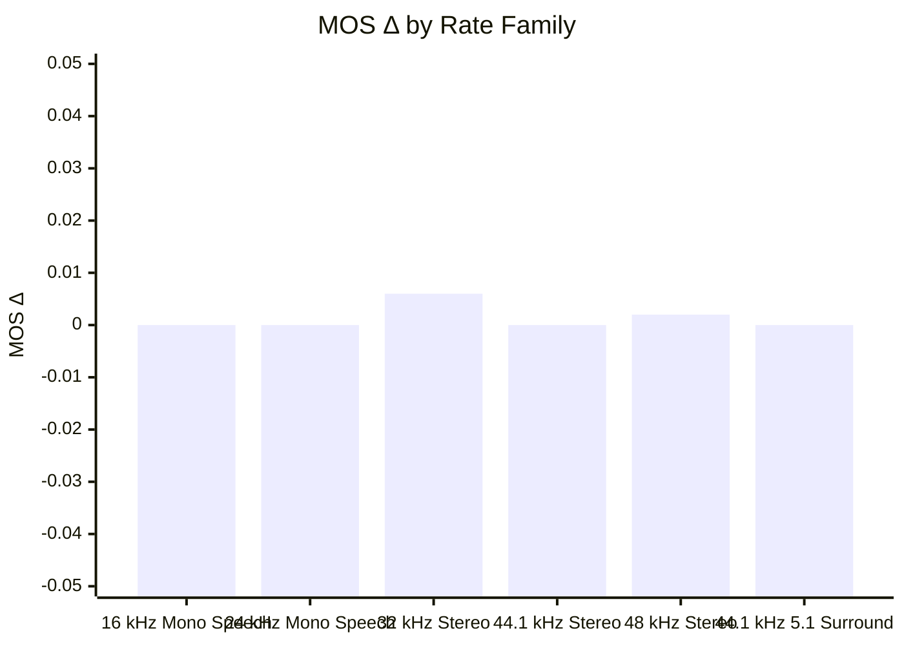
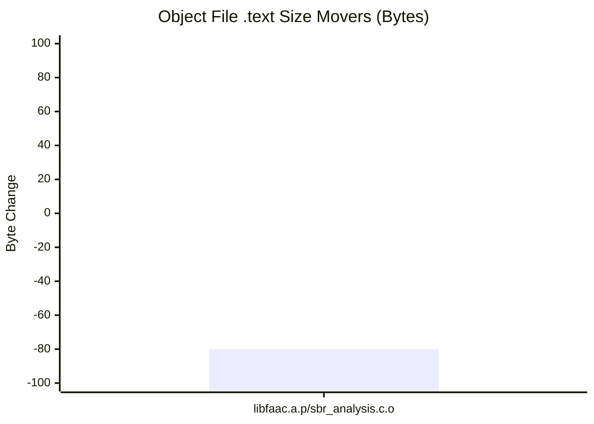

## ❌ Gapless Regression Detected

### Environment
- **Baseline SHA**: `d7a6effe22e0dd86d30c9147649542b937021c7d`
- **Candidate SHA**: `c50b66aab79f754fc17e2550159a861d26403b65`

### Executive 3-Pillar Balance
| Pillar | Metric | Change vs Baseline | Status |
| :--- | :--- | :---: | :---: |
| 🎧 **Quality** | Perceptual MOS Δ | `+0.002 MOS` | ✅ Pass |
| ⚡ **Performance** | Speed (Throughput Δ) | `+0.0%` | ✅ Pass |
| 📦 **Footprint** | Code Footprint Δ | `-0.12%` | ✅ Pass |

### Summary Details
| Metric | Value |
| :--- | :--- |
| **Regressions** | 0 ✅ |
| **Worst MOS Drop** | -0.01 (32k_stereo_48k: 27-last-song-drums-and-trampets.441.16b48k.wav) |
| **Significant Wins** | 2 🌟 |
| **Consistency** | 67.1% |
| **Throughput Δ** | +0.0%  (LC: +0.0%, HE: +0.0%) |
| **Worst-case TP Δ** | -5.2% (arm64_vbr / 24k_mono_28k) ⚠️ |
| **Library Size** | -0.12% 📉 |
| **Avg MOS Δ** | +0.002 ⚠️ Quality Churn (103 clips improved, 6 degraded) |

#### MOS Δ by Rate Family

| Family | MOS Δ | 95% Conf. Interval | Clips |
| :--- | :---: | :---: | :---: |
| 16 kHz Mono Speech | +0.000 | [+0.000, +0.000] | 128 |
| 24 kHz Mono Speech | +0.000 | [+0.000, +0.000] | 80 |
| 32 kHz Stereo | +0.006 | [+0.004, +0.008] ✳ | 245 |
| 44.1 kHz Stereo | +0.000 | [+0.000, +0.000] | 245 |
| 48 kHz Stereo | +0.002 | [+0.001, +0.002] ✳ | 637 |
| 44.1 kHz 5.1 Surround | +0.000 | [+0.000, +0.000] | 6 |

decoder output: skipped (no decoder_diff block)

<b>📋 View Scenario Performance Details</b>

### Scenario Performance
| Scenario | Rate | MOS Δ | 95% Conf. Interval | Wins / Losses | Stereo Fid. Δ | Transient | Throughput Δ | Bitrate Δ (vs Base) |
| :--- | :---: | :---: | :---: | :---: | :---: | :---: | :---: | :---: |
| **16 kHz Mono Speech** | | | | | | | | |
| 16k_mono_20k | 16k/1ch | +0.000 | [+0.000, +0.000] | 0/0 | N/A | ➖ (n=0) | -0.7% | +0.00% |
| 16k_mono_24k | 16k/1ch | +0.000 | [+0.000, +0.000] | 0/0 | N/A | ➖ (n=0) | +3.8% | +0.00% |
| 16k_mono_voip_24k | 16k/1ch | +0.000 | [+0.000, +0.000] | 0/0 | N/A | ➖ (n=0) | +5.5% | +0.00% |
| **24 kHz Mono Speech** | | | | | | | | |
| 24k_mono_28k | 24k/1ch | +0.000 | [+0.000, +0.000] | 0/0 | N/A | ➖ (n=0) | -5.2% | +0.00% |
| 24k_mono_32k | 24k/1ch | +0.000 | [+0.000, +0.000] | 0/0 | N/A | ➖ (n=0) | -1.8% | +0.00% |
| **32 kHz Stereo** | | | | | | | | |
| 32k_stereo_16k | 32k/2ch | +0.010 | [+0.005, +0.016] ✳ | 17/0 | +0.0000 | ➖ (n=595) | -0.6% | -0.04% |
| 32k_stereo_48k | 32k/2ch | +0.018 | [+0.010, +0.028] ✳ | 23/1 | -0.0001 | ➖ (n=577) | -1.1% | -0.01% |
| 32k_stereo_64k | 32k/2ch | +0.000 | [+0.000, +0.000] | 0/0 | -0.0001 | ➖ (n=478) | -1.4% | +0.00% |
| 32k_stereo_80k | 32k/2ch | +0.000 | [+0.000, +0.000] | 0/0 | -0.0002 | ➖ (n=478) | -0.9% | +0.00% |
| 32k_stereo_96k | 32k/2ch | +0.000 | [+0.000, +0.000] | 0/0 | -0.0002 | ➖ (n=478) | -1.8% | +0.00% |
| **44.1 kHz Stereo** | | | | | | | | |
| 44k1_stereo_64k | 44.1k/2ch | +0.000 | [+0.000, +0.000] | 0/0 | -0.0000 | ➖ (n=478) | -2.0% | +0.00% |
| 44k1_stereo_128k | 44.1k/2ch | +0.000 | [+0.000, +0.000] | 0/0 | +0.0000 | ➖ (n=478) | -1.6% | +0.00% |
| 44k1_stereo_160k | 44.1k/2ch | +0.000 | [+0.000, +0.000] | 0/0 | +0.0000 | ➖ (n=478) | -0.7% | +0.00% |
| 44k1_stereo_192k | 44.1k/2ch | +0.000 | [+0.000, +0.000] | 0/0 | +0.0000 | ➖ (n=478) | -0.1% | +0.00% |
| 44k1_stereo_256k | 44.1k/2ch | +0.000 | [+0.000, +0.000] | 0/0 | +0.0000 | ➖ (n=478) | -0.2% | +0.00% |
| **48 kHz Stereo** | | | | | | | | |
| 48k_stereo_16k | 48k/2ch | +0.001 | [+0.000, +0.002] ✳ | 4/0 | +0.0001 | ➖ (n=513) | -3.1% | -0.08% |
| 48k_stereo_24k | 48k/2ch | +0.002 | [+0.001, +0.003] ✳ | 8/1 | -0.0000 | ➖ (n=620) | -1.8% | -0.05% |
| 48k_stereo_32k | 48k/2ch | +0.003 | [+0.001, +0.004] ✳ | 9/0 | -0.0001 | ➖ (n=619) | -2.0% | -0.01% |
| 48k_stereo_40k | 48k/2ch | +0.004 | [+0.002, +0.006] ✳ | 12/1 | -0.0001 | ➖ (n=623) | -0.0% | -0.01% |
| 48k_stereo_48k | 48k/2ch | +0.003 | [+0.001, +0.005] ✳ | 10/1 | -0.0001 | ➖ (n=621) | +0.2% | -0.01% |
| 48k_stereo_56k | 48k/2ch | +0.004 | [+0.002, +0.005] ✳ | 10/1 | -0.0001 | ➖ (n=619) | -0.6% | -0.01% |
| 48k_stereo_64k | 48k/2ch | +0.004 | [+0.002, +0.005] ✳ | 10/1 | -0.0001 | ➖ (n=619) | +0.1% | -0.01% |
| 48k_stereo_96k | 48k/2ch | +0.000 | [+0.000, +0.000] | 0/0 | -0.0001 | ➖ (n=478) | -0.5% | +0.00% |
| 48k_stereo_128k | 48k/2ch | +0.000 | [+0.000, +0.000] | 0/0 | -0.0001 | ➖ (n=478) | -0.2% | +0.00% |
| 48k_stereo_160k | 48k/2ch | +0.000 | [+0.000, +0.000] | 0/0 | -0.0001 | ➖ (n=478) | -0.6% | +0.00% |
| 48k_stereo_192k | 48k/2ch | +0.000 | [+0.000, +0.000] | 0/0 | -0.0001 | ➖ (n=478) | -0.4% | +0.00% |
| 48k_stereo_256k | 48k/2ch | +0.000 | [+0.000, +0.000] | 0/0 | -0.0001 | ➖ (n=478) | -3.2% | +0.00% |
| 48k_stereo_320k | 48k/2ch | +0.000 | [+0.000, +0.000] | 0/0 | -0.0001 | ➖ (n=478) | -1.5% | +0.00% |
| **44.1 kHz 5.1 Surround** | | | | | | | | |
| 44k1_51_96k | 44.1k/6ch | +0.000 | N/A | N/A | +0.0000 | ➖ (n=1) | -0.2% | +0.00% |
| 44k1_51_160k | 44.1k/6ch | +0.000 | N/A | N/A | +0.0000 | ➖ (n=1) | -0.6% | +0.00% |
| 44k1_51_224k | 44.1k/6ch | +0.000 | N/A | N/A | +0.0000 | ➖ (n=1) | -2.0% | +0.00% |
| 44k1_51_256k | 44.1k/6ch | +0.000 | N/A | N/A | +0.0000 | ➖ (n=1) | -2.1% | +0.00% |
| 44k1_51_384k | 44.1k/6ch | +0.000 | N/A | N/A | +0.0000 | ➖ (n=1) | -0.5% | +0.00% |
| 44k1_51_448k | 44.1k/6ch | +0.000 | N/A | N/A | +0.0000 | ➖ (n=1) | -0.2% | +0.00% |

_Transient fidelity measures attack centroid shift (smearing/delay of transient attacks, in ms). 📈 = improved, 📉 = regression, ➖ = neutral/insufficient onsets (<30)._
_✳ Statistically significant change (95% confidence interval excludes 0)_

<b>View Additional Suite Details</b>

#### ❌ arm64_vbr
- MOS Δ: +0.002, TP Δ: +0.0%, Size Δ: -0.12%
- Bitstream Consistency: 67.1%

**Gates**
- ✅ `mos`: no clip past -0.05 over 1341 clips
- ✅ `footprint`: .text+.rodata+.data 68944 -> 68864 (-80 bytes, -0.12%)
- ✅ `throughput`: instruction count x1.000 (95% CI 1.000-1.000) over 12 signal(s)
- ✅ `bd_rate`: audio_32k/Low Complexity +0.000%, audio_44k1/Low Complexity +0.000%, audio_48k/HE-AAC v1 -0.167%, audio_48k/Low Complexity +0.000%, audio_51/Low Complexity +0.000%
- ✅ `haze`: atk_he_q50 pre-onset error +0.0 dB mean, +0.0 dB worst kick; ctl_he_q50 haze +0.0->+0.0 dB; ctl_lc_q200 haze -0.0->-0.0 dB; he_b32 haze +7.3->+7.3 dB; he_q50 haze +13.8->+13.8 dB; lc_q200 haze +15.4->+15.4 dB
- ❌ `gapless`: 96 of 96 streams tagged (96 in the baseline); 3 tagged stream(s) not sample-exact: 48k_stereo_16k_Can't Wait Until Tonight (Dry Wurlitzer Mix).16b48k.wav (+0 frames, lag -964), 48k_stereo_16k_Shinsho_pool_3min45_4min4.16b48k.wav (+0 frames, lag -391), 48k_stereo_16k_girl.16b48k.wav (+0 frames, lag -89)

**BD-rate** (positive = more bits for equal quality = worse)
| Ladder | Rungs | Clips | Mean | Median |
| :--- | :---: | :---: | :---: | :---: |
| audio_32k / Low Complexity | 3 | 49 | +0.000% | +0.000% |
| audio_44k1 / Low Complexity | 5 | 49 | +0.000% | +0.000% |
| audio_48k / HE-AAC v1 | 7 | 49 | -0.167% | -0.070% |
| audio_48k / Low Complexity | 6 | 49 | +0.000% | +0.000% |
| audio_51 / Low Complexity | 6 | 1 | +0.000% | +0.000% |
- audio_32k / HE-AAC v1: 2 rung(s), needs 3 -- skipped
- speech_clean_16k / Low Complexity: 2 rung(s), needs 3 -- skipped
- speech_clean_24k / Low Complexity: 2 rung(s), needs 3 -- skipped
- speech_voip_16k / Low Complexity: 1 rung(s), needs 3 -- skipped

**Object .text movers**

`libfaac.a.p/sbr_analysis.c.o` -80

_Full per-clip test cases (1341 total) exported to `cases_vbr.md`._

